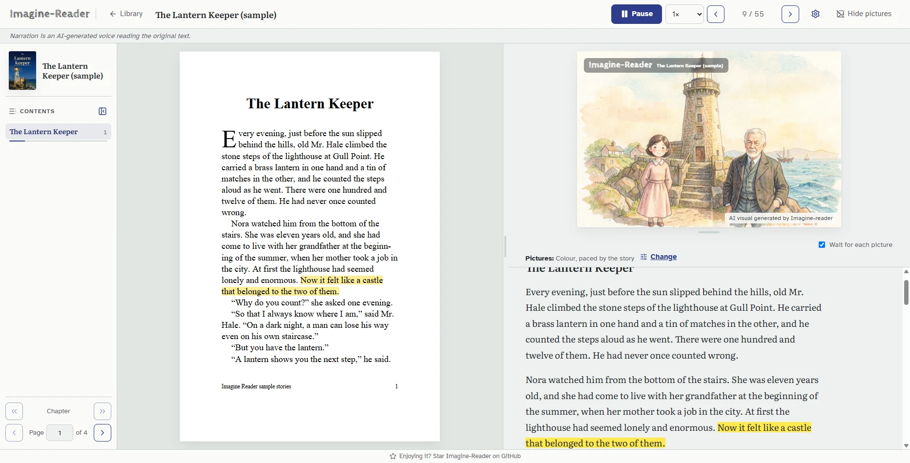

# Imagine-Reader

**Listen and imagine a book, read from its own pages.**

Imagine-Reader reads a PDF book aloud in its own words, highlights each
sentence on the real page, and draws the story beside it as it goes. In
English and Bangla. Open source, and it runs on your own computer.

[](https://github.com/ihsonnet/imagine-reader/actions/workflows/ci.yml)
[](LICENSE)
[](https://imagine-reader.ihsonnet.com)

**[Try the sample books](https://imagine-reader.ihsonnet.com)** in your
browser: no sign-up, no key.



## What it does

- **Reads the book's own words.** Nothing is rewritten or summarised. The
  highlight follows the voice on the original page.
- **Sounds like a storyteller.** Google's Gemini reads slowly and warmly,
  pausing at paragraphs and scene breaks.
- **Draws the story as it happens.** The AI reads the whole book first, then
  storyboards each chapter. Pictures change with the scene, and characters
  keep the same face from start to finish.
- **Starts at Chapter 1.** The title page, copyright and contents are
  skipped, and every chapter is one click away.
- **Reads Bangla properly**, including PDFs made in Google Docs, whose hidden
  text is scrambled.

| Pencil sketch | Colour | Colour, more detail | Studio Ghibli style |
| --- | --- | --- | --- |
|  |  |  |  |

*Drawn by Imagine-Reader from* Alice's Adventures in Wonderland. *Not
affiliated with Studio Ghibli.*

## Run it on your computer

You need [Docker](https://www.docker.com/products/docker-desktop/) and an
[OpenRouter key](https://openrouter.ai/keys) with a few dollars of credit.

```bash
git clone https://github.com/ihsonnet/imagine-reader.git
cd imagine-reader
cp .env.example .env     # then paste your key after OPENROUTER_API_KEY=
docker compose up -d
```

Open **http://localhost:8000** and add a PDF with real text, not a scan. The
first start takes a few minutes. After that it starts in seconds.

- **No key yet?** The samples still play. Your own books get placeholders.
- **Changed `.env`?** Run `docker compose up -d` again.
- **Stop** with `docker compose down`; your books are kept. **Update** with
  `git pull && docker compose up -d --build`.
- **Something wrong?** `docker compose logs -f worker` shows what failed, or
  [open an issue](https://github.com/ihsonnet/imagine-reader/issues/new/choose).
  Leave your key out of anything you paste.

Your key stays in `.env` on your computer. There are no accounts and no
tracking, and the reader only answers on your own computer.

## What it costs

**You pay once per book.** The voice and pictures are made the first time you
listen, then kept, so reading a book again costs nothing. You pay the model
providers directly, at their list prices. Making one hour of a book costs
about:

| | OpenRouter only | With Cloudflare for pictures |
| --- | ---: | ---: |
| Voice, and checking it | $1.35 | $1.35 |
| Planning the pictures | $0.10 | $0.10 |
| Pictures | $2.22 | $0.49 |
| **Total** | **$3.70** | **$1.95** |

- **Only what you listen to is made**, a little ahead of you. Stop after one
  chapter, and you pay for about one chapter.
- **A new picture style or pace** draws a new set of pictures, once.
  Switching back to one you used before is free.
- **Spending is capped.** `IR_DAILY_SPEND_LIMIT_USD` (default $5) limits what
  it spends each day. At the limit, the voice and pictures wait for the next
  day, with nothing cheaper standing in.
- **Pictures for less.** Add `CLOUDFLARE_ACCOUNT_ID` and
  `CLOUDFLARE_API_TOKEN` (with the Workers AI permission) to `.env`.
  Cloudflare draws with the same model for about a tenth of the price, and
  the first 60 or so pictures a day are free.

## How it works

```
PDF ─► text, reading order, sentences, highlight boxes
         ├─► voice:    Gemini reads aloud ─► Gemini times each sentence ─► OpenAI checks each cut
         ├─► story:    OpenAI reads the whole book ─► storyboards each chapter
         └─► pictures: FLUX.2 [klein] draws each scene of the storyboard
```

A Python engine reads the PDF and plans the story. A FastAPI server and its
worker prepare the voice and pictures ahead of you. A React and PDF.js reader
keeps them in step with the page.
[How it works, in detail](docs/how-it-works.md).

## Settings

All settings go in `.env`. Run `docker compose up -d` again after a change.

| Variable | Default | What it does |
| --- | --- | --- |
| `OPENROUTER_API_KEY` | | Plans the pictures, reads aloud, checks the voice and draws the pictures. |
| `CLOUDFLARE_ACCOUNT_ID`, `CLOUDFLARE_API_TOKEN` | | Optional. Draws the pictures on Cloudflare instead, for less. |
| `IR_DAILY_SPEND_LIMIT_USD` | `5` | The most it may spend per UTC day. |
| `IR_SKETCH_STYLE` | `pencil` | `pencil`, `color`, `color-hd` or `ghibli`. |
| `IR_PORT` | `8000` | The port to open in your browser. |

The rest are in
[`config.py`](server/src/imagine_reader_server/config.py).
Imagine-Reader is for one person: everyone who can reach it sees every book
and spends your key.

## Contributing

Help is welcome, and most of it needs no code. You can
[report a book that reads badly](https://github.com/ihsonnet/imagine-reader/issues/new?template=book-reads-badly.yml),
[report a bug](https://github.com/ihsonnet/imagine-reader/issues/new?template=bug-report.yml)
or [suggest an idea](https://github.com/ihsonnet/imagine-reader/issues/new?template=idea.yml).
Bigger pieces that are open: reading scanned pages, more languages, a desktop
app, and accessibility.

To change the code you need Python 3.11+ and Node.js 22, but no AI key:
everything runs with placeholders.
[CONTRIBUTING.md](CONTRIBUTING.md) explains how to set it up and run the
checks. If Imagine-Reader is useful to you, a ⭐ helps others find it.

## Licence and credits

[MIT](LICENSE).

- **Sample books.** *The Lantern Keeper* was written for this project (CC0).
  *দেবদাস* (Sarat Chandra Chattopadhyay, 1917) and *কাবুলিওয়ালা* (Rabindranath
  Tagore, 1892) are in the public domain, from Bangla Wikisource
  ([sources](server/src/imagine_reader_server/samples/SOURCES.md)).
- **Screenshots** show *A Room with a View* (E. M. Forster, 1908, Standard
  Ebooks) and *Alice's Adventures in Wonderland* (Lewis Carroll), both in the
  public domain.
- **Fonts and icons.** Literata, Atkinson Hyperlegible, Caveat, Cabin Sketch
  and the Noto Bengali fonts are under the SIL Open Font License. Lucide
  icons are under ISC.
- **AI.** The voice is Google's Gemini. The pictures are Black Forest Labs'
  FLUX.2 [klein]. Planning and voice checks are OpenAI's models. All of them
  are marked as AI-made in the reader.

[Security](SECURITY.md) · [Code of Conduct](CODE_OF_CONDUCT.md)
