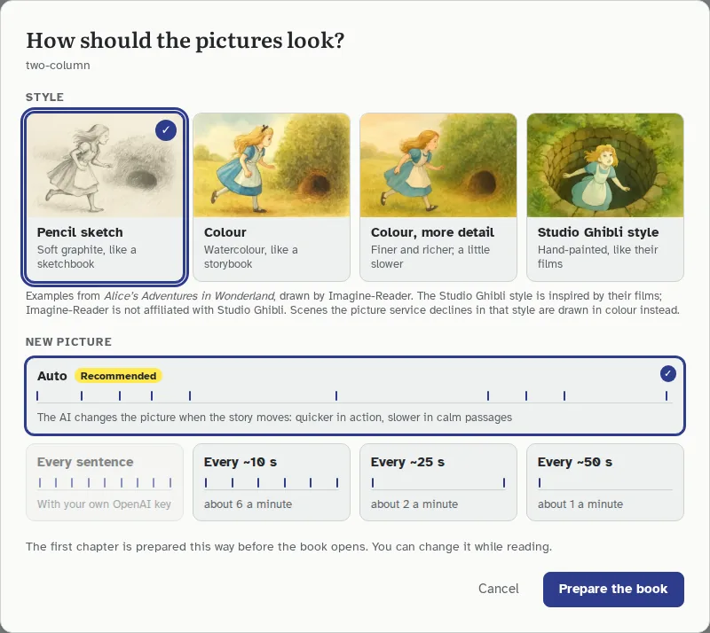

# Imagine-Reader

**Listen and imagine a book, read from its own pages.**

Imagine-Reader is an open-source reader for PDF books. It reads the book's
original text aloud and highlights each sentence on the real page as it goes.
Beside the page, AI pictures follow the story, changing as the story moves.
It reads English and Bangla.

[](https://github.com/ihsonnet/imagine-reader/actions/workflows/ci.yml)
[](LICENSE)
[](https://imagine-reader.ihsonnet.com)

**Try the samples at [imagine-reader.ihsonnet.com](https://imagine-reader.ihsonnet.com)**: three
books, one in English and two in Bangla, with their voice and pictures ready.
To read your own books, [run it on your computer](#run-it-on-your-computer)
with one OpenRouter key.


> **Early preview.** The voice is AI-generated and the pictures are AI-drawn
> interpretations. Scanned pages cannot be read yet. Expect rough edges, and
> please [tell us about them](https://github.com/ihsonnet/imagine-reader/issues/new/choose).

**Contents:** [Run it](#run-it-on-your-computer) ·
[What it costs](#what-it-costs) · [What it does](#what-it-does) ·
[How it works](#how-it-works) · [Settings](#settings) ·
[Development](#development) · [Contributing](#contributing) ·
[Licence](#licence-and-credits)

## Run it on your computer

It runs the same way on Windows, macOS and Linux. You need
[Docker Desktop](https://www.docker.com/products/docker-desktop/) (on Linux,
Docker Engine with the Compose plugin) and an
[OpenRouter key](https://openrouter.ai/keys) with a few dollars of credit.

```bash
git clone https://github.com/ihsonnet/imagine-reader.git
cd imagine-reader
cp .env.example .env          # Windows Command Prompt: copy .env.example .env
```

Open `.env` in any text editor and paste your key after
`OPENROUTER_API_KEY=`. Then start it:

```bash
docker compose up -d
```

Open **http://localhost:8000**. The first start builds the app, which takes
a few minutes, and downloads the sample books' voice and pictures (about
140 MB). After that it starts in seconds. Add a PDF, choose how the pictures
should look, and the book opens once its first chapter is ready.

- **No key yet?** The samples play without one. Your own books get
  placeholders (soft clicks for the voice, labelled cards for the pictures)
  until you add a key and run `docker compose up -d` again.
- **Stop it** with `docker compose down`. Your books stay in a Docker volume
  until you delete them in the reader (or run `docker compose down -v`, which
  deletes everything).
- **Update it** with `git pull` and `docker compose up -d --build`.
- **Your key stays on your computer.** It is read from `.env` when the
  containers start and is never copied into the image. There are no accounts,
  cookies or tracking, and the reader can only be reached from your own
  computer.

One OpenRouter key does everything: it reaches OpenAI's model to plan the
pictures, Google's Gemini storyteller to read aloud, OpenAI's recogniser to
check each recording, and FLUX.2 to draw. No other account is needed, but a
Cloudflare account can draw the pictures for much less (see
[What it costs](#what-it-costs)).

### If something goes wrong

- **Port 8000 is already in use.** Add `IR_PORT=8080` (or any free port) to
  `.env`, run `docker compose up -d` again, and open that port instead.
- **A new or changed key has no effect.** The containers read `.env` only
  when they start: run `docker compose up -d` again after every change.
- **Your own book gets placeholders.** No key was found: check that it is
  pasted right after `OPENROUTER_API_KEY=` in `.env`, then run
  `docker compose up -d` again.
- **"Your AI key was refused."** The key is wrong, or its account has no
  credit left. Check both on [openrouter.ai](https://openrouter.ai/settings/credits).
- **The pictures or voice stopped for the day.** The daily spending limit was
  reached (see [What it costs](#what-it-costs)). They carry on after midnight
  UTC, or straight away if you raise `IR_DAILY_SPEND_LIMIT_USD`.
- **Anything else.** The worker's log says what it is doing and what went
  wrong: `docker compose logs -f worker`.
- **Still stuck?** [Open an issue](https://github.com/ihsonnet/imagine-reader/issues/new/choose)
  with what you did and what you saw. Leave your key out of anything you paste.

### What it costs

You pay for what your books use, at the models' list prices. An hour of
narrated reading costs about:

| | OpenRouter only | OpenRouter + Cloudflare for pictures |
| --- | --- | --- |
| Voice (Gemini) | $0.81 | $0.81 |
| Checking each recording | $0.54 | $0.54 |
| Reading the book and planning its pictures | $0.10 | $0.10 |
| Pictures (FLUX.2 [klein]) | $2.22 (a picture every 25 seconds) | $0.49 (Auto: 4 or 5 a minute) |
| **Total** | **about $3.70** | **about $1.95** |

Pictures cost about ten times as much through OpenRouter as on Cloudflare,
so with OpenRouter alone a new picture appears about every 25 seconds by
default; you can choose more in the reader. For cheaper pictures, add a
Cloudflare account to `.env` (`CLOUDFLARE_ACCOUNT_ID` and
`CLOUDFLARE_API_TOKEN`, a token with the Workers AI permission): it draws the
same pictures, and its first 60 or so a day are free. Bangla is read by a
cheaper voice model than English, so Bangla books cost a little less.

Everything made is kept, so reading a book again costs nothing.
`IR_DAILY_SPEND_LIMIT_USD` in `.env` (default $5) caps what your keys may
spend each UTC day. When it is reached, the voice and pictures wait for the
next day; nothing cheaper stands in.

## What it does

- **Reads the book's own words.** Nothing is rewritten or summarised. The voice
  reads each sentence exactly as printed, and the highlight follows it on the
  original page and in the text beside it.
- **Tells stories like a storyteller.** A slow, warm voice (Gemini's Charon),
  with longer pauses at paragraphs and scene breaks.
- **Opens at Chapter 1, with the chapters to hand.** The title page, copyright
  notice and contents are skipped, and a contents panel lists the chapters
  from the book's own headings.
- **Pictures that follow the story.** The AI reads the whole book first, then
  plans each chapter like a film's storyboard: where the picture changes, and
  what each picture shows, knowing what has happened so far.
- **Auto pace, or your own.** With Auto, the story sets the pace: pictures
  change quickly in action and more slowly in calm passages, about four or
  five times a minute. Or choose a new picture every sentence, or about every
  10, 25 or 50 seconds.
- **Keeps characters recognisable.** Each main character is drawn once as a
  reference portrait, so the same face, hair and clothes appear throughout.
  Nobody appears before the text has introduced them.
- **Four picture styles.** Pencil sketch, colour, colour with more detail, and
  a Studio Ghibli-inspired style:

  | Pencil sketch | Colour | Colour, more detail | Studio Ghibli style |
  | --- | --- | --- | --- |
  |  |  |  |  |

  *Examples from* Alice's Adventures in Wonderland*, drawn by Imagine-Reader.
  Imagine-Reader is not affiliated with Studio Ghibli.*

<p align="center">
  
</p>

## How it works

```
PDF ─► engine: text layer, reading order, sentences, highlight boxes
         │
         ├─► front matter skipped ─► opens at Chapter 1
         ├─► voice: a paragraph at a time, cut into sentences
         │          read by gemini-3.8-flash-tts (Bangla: gemini-3.8-flash-lite-tts), voice Charon
         │          timed by gemini-3.8-flash, each cut checked by gpt-4o-transcribe
         └─► story bible: cast, objects, places, setting, chapter notes (gpt-5.4-mini, once per book)
                 └─► storyboard per chapter: where each picture starts, what it shows, how it is framed
                         └─► reference portraits ─► pictures (FLUX.2 [klein] 4B)

server: FastAPI + a background worker; jobs, cache, the daily limit and the spending ledger in SQLite
reader: React + PDF.js; the page, the highlight, the voice and the pictures, kept in step
```

Every model is reached through OpenRouter, with your one key, except the
pictures when a Cloudflare account draws them. The voice and pictures are
prepared ahead of the reader, a chapter at a time, so they are ready when the
reader gets there.

### Reading the PDF

- **Real layouts.** The engine reads the PDF's text layer with pdfplumber
  and works out the reading order across single and two columns, on rotated
  and cropped pages. It skips running headers, footers and page numbers,
  rejoins words hyphenated across lines, and reattaches drop caps. Each
  sentence keeps its boxes on the page, which the highlight is drawn from.
- **Lost letters recovered.** Some PDFs, such as e-books printed from a
  browser, store small capitals without their letters. The engine recovers
  them from the font, so a chapter title reads "In Santa Croce with No
  Baedeker", not "I S C N B".
- **Bangla PDFs from Google Docs.** Bangla PDFs made in Google Docs or printed
  from Chrome label their letters out of order and leave conjuncts out. The
  engine reads their words back from the glyphs on the page: it shapes
  syllables with HarfBuzz and the bundled Noto Sans Bengali, and splits each
  word into the syllables that make exactly its glyphs.
- **Bangla sentences and names.** Bangla sentences end at the dari (।), and
  names are found with their case endings (রহমতের, রহমতকে).
- **Front matter skipped.** The title page, copyright notice and contents are
  recognised, so the book opens at Chapter 1.
- **Scanned PDFs are refused** with a clear message, before anything is spent.

### The voice

- **A paragraph at a time.** Gemini reads a run of sentences in one go, laid
  out one sentence per line, with a direction to read slowly and warmly, so
  they flow into each other as a storyteller's would.
- **Cut into sentences.** A second Gemini model hears the recording and marks
  where each sentence starts, so the highlight moves sentence by sentence.
  Each cut is moved to the nearest real pause (at least 0.15 seconds of
  silence), never into a word.
- **Every cut checked.** OpenAI's recogniser hears each sentence's clip. If a
  clip ends more than a few letters away from where its sentence ends, the
  run is read again in smaller pieces. A sentence the voice refuses to read
  (garbled source text, for instance) is left silent rather than read wrong.
- **Recorded ahead.** Three runs are recorded at once, ahead of the reader.

### The pictures

- **The whole book first.** Before any picture is planned, the language model
  reads the whole book once and writes its story bible: the cast, objects and
  places, the setting, and notes on each chapter. It fixes how each one looks,
  including gender, age and species, and how their names are written in the
  book, so a Bangla book's characters are found in its Bangla text.
- **People met before they are named.** Stories often introduce someone as
  "the old man" or "a tall stranger" long before giving a name. The bible
  records how the story first refers to each person, so they are drawn as the
  same person before and after they are named, and never before they appear.
- **A storyboard for each chapter.** The model plans where each picture starts
  and what it shows, knowing what has happened so far, and never shows the
  same view twice in a row. With Auto, it is given the chapter's narrated
  length and asked for a picture about every 13 seconds, more in action and
  fewer in calm passages; a picture held much longer than 30 seconds is split.
  Long chapters are planned four minutes at a time.
- **Framing and portraits.** Each picture is framed as a wide, medium or close
  shot. The main characters' reference portraits go only with close shots, so
  wider pictures are composed freely instead of copying the portrait's pose.
- **Drawn by FLUX.2 [klein] 4B**, through OpenRouter or on Cloudflare, in the
  chosen style: 3:2 for scenes, square for portraits.

### Never worse, only later

The voice, planning and pictures always come from the same models. When a
limit is reached (the daily spending limit, a provider's rate limit, or an
account out of credit), the work waits and carries on later. Nothing cheaper
or rougher stands in, so a book never ends up with a mix of voices or picture
models. Each request's estimated cost is recorded in a spending ledger, which
the daily limit is checked against.

Recordings and pictures are cached under the model, voice and plan that made
them, so nothing is paid for twice.

## Settings

Settings come from `.env` (or environment variables). The full list, with
comments, is in
[`server/src/imagine_reader_server/config.py`](server/src/imagine_reader_server/config.py).
After a change, run `docker compose up -d` again. The ones you are most
likely to change:

| Variable | Default | What it does |
| --- | --- | --- |
| `OPENROUTER_API_KEY` | (none) | The one key that does everything: planning, the voice and its checks, and the pictures unless Cloudflare is set. |
| `CLOUDFLARE_ACCOUNT_ID`, `CLOUDFLARE_API_TOKEN` | (none) | Optional: draws the pictures on Cloudflare Workers AI, for about a tenth of OpenRouter's price. The token needs the Workers AI permission. |
| `IR_DAILY_SPEND_LIMIT_USD` | `5` | What your keys may spend per UTC day. |
| `IR_SKETCH_STYLE` | `pencil` | The default picture style: `pencil`, `color`, `color-hd` or `ghibli`. |
| `IR_SKETCH_WORDS` | `60`, or Auto with Cloudflare | The default pace: `0` is Auto; or a new picture after `1`, `25`, `60` or `120` words. |
| `IR_SPEECH_VOICE` | `Charon` | The Gemini voice. |
| `IR_MAX_PAGES` / `IR_MAX_WORDS` | `1000` / `400000` | Upload limits. Longer books can be read up to the limit. |
| `IR_PORT` | `8000` | The port on your computer. |

Imagine-Reader is made for one person on their own computer. It has no
accounts, so do not open it to other people: everyone who can reach it sees
every book, and spends your keys.

### The sample pack

The samples' voice and pictures are not in the repository. They come in a
sample pack, a release asset that the worker downloads and installs on first
start. It holds each sample's reading, story bible, storyboards, pictures and
recordings. It is installed only if its SHA-256 is the published pack's, and
each sample only if it was made from the same PDF as the one in the
repository, so the recordings match their sentences. Turn it off with
`IR_SAMPLES=false`, or use a pack of your own: set `IR_SAMPLE_PACK_URL` to its
URL or file path, and `IR_SAMPLE_PACK_SHA256` to its SHA-256 (or leave that
empty to skip the check).

To make a pack, prepare the samples with your key (`IR_PREPARE_SAMPLES=true`),
then run this with the reader's data folder:

```bash
python tools/make_sample_pack.py DATA_DIR samples-1.tar.gz
```

It prints the pack's size and SHA-256.

## Development

You need Python 3.11 or newer and Node.js 22.

```bash
python3 -m venv .venv
.venv/bin/pip install -e "engine[dev]" -e "server[dev]"
(cd reader && npm install)
```

Run the API, the worker and the reader in three terminals, from the
repository root:

```bash
.venv/bin/uvicorn --factory imagine_reader_server.api:create_app --port 8000
.venv/bin/python -m imagine_reader_server.worker
(cd reader && npm run dev)        # http://localhost:5173
```

You can also build the reader once (`cd reader && npm run build`) and open
http://localhost:8000, which then serves it. Without any key, everything runs
with placeholders, so you can develop and test without paying for AI.

Run the checks before you open a pull request. CI runs the same checks:

```bash
.venv/bin/python -m pytest engine server
(cd reader && npm test && npm run build)
.venv/bin/ruff check . && .venv/bin/ruff format --check .
```

The database schema is managed with Alembic and upgraded on startup. After
you change the models in `db.py`, add a migration:

```bash
.venv/bin/alembic -c server/alembic.ini revision --autogenerate -m "describe the change"
```

### Using the engine on its own

```python
from imagine_reader.ingestion import ingest_pdf

document = ingest_pdf("fixtures/pdfs/two-column.pdf")
print(document.sentences[1].narration_text)
print(document.sentences[1].boxes)  # fractions of the visible page, origin top-left
```

### Test fixtures

`fixtures/generate_pdfs.py` lays out the sample story in `fixtures/stories/`
as several PDFs: single column, two columns, rotated, cropped, a paperback
page with a drop cap and footers, and a scanned page. It writes a
ground-truth file for each, so the tests check extraction against known
answers. `fixtures/generate_shaped_pdf.py` prints a short Bangla story with
Chrome, the way Google Docs prints it.

### Repository layout

| Path | Contents |
| --- | --- |
| `engine/` | The reusable Python engine (`imagine_reader`): PDF reading (`ingestion/`), story planning (`story/`), and the AI providers (`providers/`) |
| `server/` | The API and the background worker (`imagine_reader_server`), with the sample PDFs |
| `reader/` | The web reader |
| `fixtures/` | The sample story, the PDF generator, and the generated PDFs with their ground truth |
| `tools/` | Scripts that built the samples and the sample pack |
| `docs/` | Images for this README |

## Roadmap

These are open, and help is welcome:

- Reading scanned pages and PDFs with a broken text layer, which is common
  for Bangla books, using cloud OCR.
- More languages for sentence splitting, name finding and the voice.
- A desktop app, so no Docker is needed.
- An interface in more languages, and better accessibility.

## Contributing

Contributions of every size are welcome, and most need no code:

- **[Report a book that reads badly](https://github.com/ihsonnet/imagine-reader/issues/new?template=book-reads-badly.yml)**:
  a wrong reading order, a header read aloud, a sentence cut in half.
- **[Report a bug](https://github.com/ihsonnet/imagine-reader/issues/new?template=bug-report.yml)**
  in the reader, the voice or the pictures.
- **[Suggest an idea](https://github.com/ihsonnet/imagine-reader/issues/new?template=idea.yml)**,
  such as a picture style or a language.
- **Improve the code or the documentation.** Issues labelled
  [`good first issue`](https://github.com/ihsonnet/imagine-reader/labels/good%20first%20issue)
  are a good place to start, and the [roadmap](#roadmap) lists bigger pieces.

To send a change:

1. Fork the repository and create a branch from `main`.
2. Set it up as in [Development](#development). No AI key is needed.
3. Make one change, with tests for what it adds or fixes.
4. Run the checks in [Development](#development), then open a pull request
   and fill in its template.

For anything larger than a small fix, open an issue first so we can agree on
the approach. [CONTRIBUTING.md](CONTRIBUTING.md) has the details: where the
code is, how it is tested, and the style it follows.

If Imagine-Reader is useful to you, **starring the repository** helps other
readers and contributors find it.

Everyone taking part is expected to follow the
[Code of Conduct](CODE_OF_CONDUCT.md). To report a security problem, see
[SECURITY.md](SECURITY.md). Please do not open a public issue for it.

## Licence and credits

Imagine-Reader is licensed under the [MIT License](LICENSE). By contributing,
you agree that your contributions are licensed under it too.

- *The Lantern Keeper*, the English sample and test story, was written for
  this project and is dedicated to the public domain (CC0).
- *দেবদাস* (Devdas) by Sarat Chandra Chattopadhyay (1917) and
  *কাবুলিওয়ালা* (Kabuliwala) by Rabindranath Tagore (1892) are in the public
  domain. Their text comes from Bangla Wikisource. See
  [the sample sources](server/src/imagine_reader_server/samples/SOURCES.md).
- The example pictures were drawn by Imagine-Reader from *Alice's Adventures
  in Wonderland* by Lewis Carroll, which is in the public domain.
- The reader screenshot shows *A Room with a View* by E. M. Forster (1908),
  in the public domain, from the Standard Ebooks edition.
- Fonts: Literata, Atkinson Hyperlegible, Caveat, Cabin Sketch and Noto Serif
  Bengali, all under the SIL Open Font License. The engine ships Noto Sans
  Bengali (SIL Open Font License) to read Bangla PDFs made in Google Docs.
  Icons: Lucide (ISC).
- The voices are made with Google's Gemini models, the pictures with Black
  Forest Labs' FLUX.2 [klein], and the story planning and voice checks with
  OpenAI's models, reached through OpenRouter (and Cloudflare, for pictures,
  when it is set). They are labelled as AI-generated wherever they appear.
